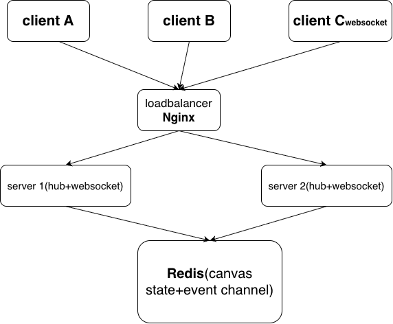

# Pixelcanvas

A distributed collaborative pixel canvas

## Architecture



The canvas is infinite, split into 64×64 chunks. Each chunk is one Redis key (3 bytes RGB per pixel).

### Pixel flow

```
browser --WebSocket--> server (handleMessage)
  -> Lua script in Redis, atomic: check chunk open, read old color, write new color, log to canvas events
  -> Publish pixels
  -> every subscriber -> hub -> its browsers
```

## Run locally

```
docker run -d --name redis -p 6379:6379 redis:7
go run .                          # :8080
PORT=8081 SERVER_ID=s2 go run .   # second server
go test ./...
```

Config is via env vars: `PORT`, `SERVER_ID`, `REDIS_ADDR`, `MAX_CHUNKS`, `CHUNK_POLICY` (adjacent|free), `BROADCAST_MODE` (global).

## API

| | |
|---|---|
| `GET /api/chunks` | open chunks `[{"cx":0,"cy":0}]` |
| `GET /api/chunk/:cx/:cy` | raw RGB bytes of one chunk |
| `POST /api/chunks` `{"cx":1,"cy":0}` | open a chunk (201 / 403 / 409 / 507) |
| `GET /ws` | WebSocket |

WebSocket messages are JSON with a `type`:
- send: `{"type":"pixel","x":10,"y":-3,"color":"#ff8800"}`
- receive: `pixel` (same fields + `user_id`, `timestamp`), `chunk_added`, `error`

## Adding rollback

Every change is in the Redis Stream `canvas:events`:

```
<id>  type=pixel x=10 y=10 color=#0000ff prev_color=#ff0000 user_id=... timestamp=...
<id>  type=chunk_added cx=0 cy=1
```

Read it with `NewEventLog(rdb).Range(...)` / `.RevRange(...)` in `eventlog.go`.

The stream ID is the global sequence number. Order by it, not by `timestamp`.

Each entry has both `color` and `prev_color`, so either rollback style works:
- Replay (planned): start from the nearest snapshot and apply `color` forward up to the target ID. Snapshots are not built yet.
- Reverse undo: walk newest first and set each pixel back to `prev_color`.

## Tech Stack
- Go + Gin
- WebSocket (gorilla/websocket)
- Redis (state + Pub/Sub + Streams)
- Nginx (load balancer)

## Team
- Xiang Li
- Alexandra Descoteaux